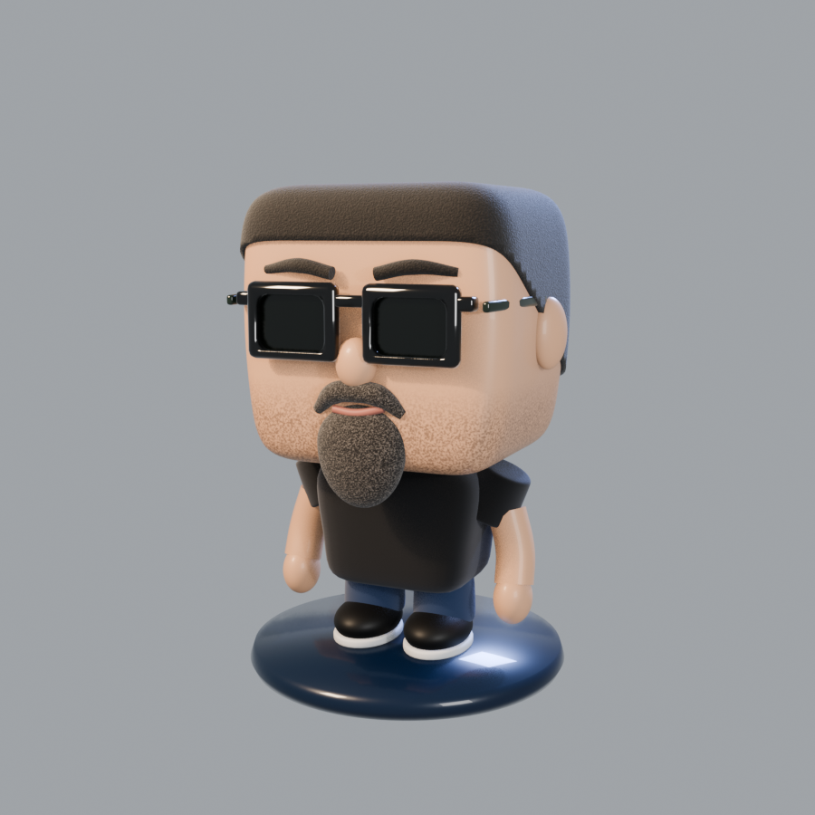
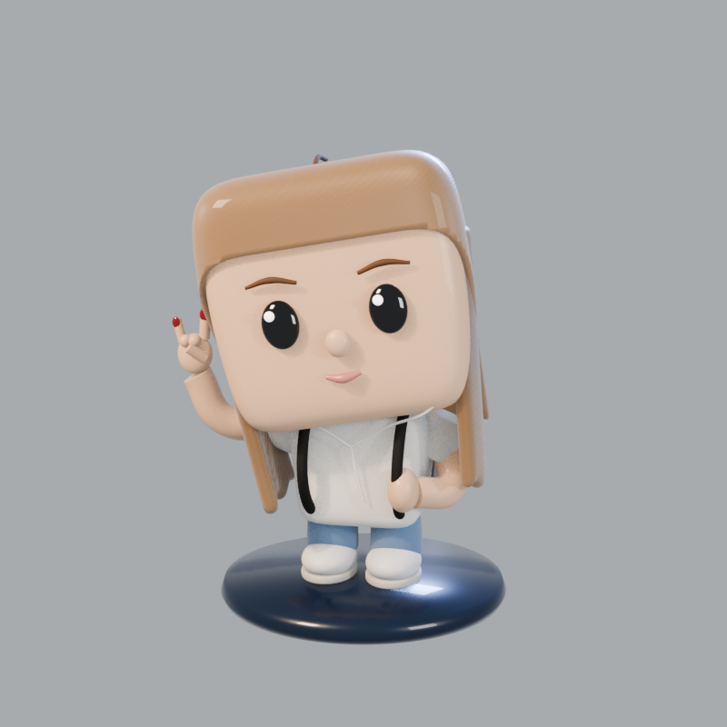

# buho-blender

CLI para que un agente de IA (Claude Code, Codex, Gemini, scripts) **modele, esculpa, anime, renderice y exporte en Blender** desde la terminal. Hecho por [Búho AI](https://buhoai.es).

- **En directo**: habla con el Blender abierto por el puerto del complemento oficial «MCP» de Blender Lab (9876) y lo que hace el agente se ve en la ventana.
- **Sin ventana** (`--fondo`): lanza `blender -b` para generar, renderizar y exportar en lote.
- Node 18+ sin dependencias. Probado con Blender 5.2 LTS en Windows.

## Qué sabe hacer

| Área | Comandos |
|---|---|
| Ver y medir | `estado`, `escena`, `stats`, `pantalla`, `docs <término>` |
| Ejecutar | `run <script.py>`, `vigilar <script.py>` (re-ejecuta al guardar) |
| Fotos y vídeo | `captura` (vistas sueltas u hoja de vistas, EEVEE o Cycles en GPU), `giro` (360° en MP4/GIF), `video` (cámara fija, frontal u órbita) |
| Esqueleto y animación | `esqueleto` (humanoide, cuadrúpedo, cadena), `animar` (andar, puñetazos, saludar, saltar, bailar, idle… o poses en JSON), `importar-animacion` (Mixamo) |
| Comparar con una referencia | `comparar foto.png` (referencia, render, superposición y siluetas, con métricas) |
| Renders largos | `--en-cola` y `cola` (progreso y tiempo restante, cancelar) |
| Llevarlo fuera | `optimizar` (baja de polígonos + bake PBR a GLB/FBX para Unity o web), `imprimir` (STL/3MF cerrado en mm, vaciado), `visor` (HTML con visor 3D) |
| Archivos | `importar`, `exportar` (GLB/FBX/OBJ, `--unir`), `guardar`, `cargar`, `nuevo`, `limpiar`, `abrir` |

Librerías Python para los scripts del agente (`import buho3d`, `import buho_sdf`, `import buho_rig`):

- **buho3d**: primitivas, materiales PBR y de nodos, reparto de instancias sobre superficies, cámara, luces de estudio, niebla volumétrica, render y bloom.
- **buho_sdf**: escultura por campos de distancia. Las formas se funden como arcilla y salen en **una sola malla orgánica** (numpy → OpenVDB → Volume to Mesh), con relieve tallado (plumas, escamas, grabados) y máscaras como atributos para los materiales.
- **buho_rig**: esqueletos y acciones.

La guía completa para agentes está en [SKILL.md](SKILL.md).

## Ejemplos

Todo lo de esta galería lo ha modelado un agente con el CLI, desde cero y sin generadores de imagen a 3D. El código de cada uno está en [`modelos/`](modelos).

**Búho esculpido** con `buho_sdf`: una pieza, plumas talladas, oro en los relieves (Cycles).


**Figuras de vinilo** a partir de una foto: el señor Juan (con animación de puñetazos y vídeo en 360°) y María.

| | |
|---|---|
|  |  |


Vídeos: [puñetazos](modelos/funko_juan/funko_juan_punetazos.mp4) · [puñetazos con cámara en 360°](modelos/funko_juan/funko_juan_punetazos_360.mp4)

**Logo en 3D** calcado de la imagen oficial y extruido con bisel ([vídeo girando](modelos/logo_ucam_hitech/logo_ucam_hitech_giro.mp4)). El logo de UCAM HiTech pertenece a la Universidad Católica de Murcia y se incluye solo como demostración.


## Instalación

```bash
git clone https://github.com/julianfdz/BuhoAI-Blender-CLI
cd BuhoAI-Blender-CLI
npm run instalar        # shim en %LOCALAPPDATA%\Programs\BuhoBlender\cli y PATH del usuario (Windows)
```

1. Instala Blender (5.2 LTS) y el complemento «MCP» de Blender Lab; en Preferencias activa **Permitir acceso online** (sin eso el complemento no abre el puerto).
2. Si Blender no está en `D:\Programas\Blender\blender.exe`, define `BUHO_BLENDER_PATH`.
3. Para agentes: copia `SKILL.md` a la carpeta de skills de tu agente (en Claude Code, `~/.claude/skills/buho-blender/SKILL.md`).

```bash
buho-blender estado
buho-blender run modelos/buho_estatua/buho_esculpido.py --fondo --guardar buho.blend
buho-blender captura buho.png --fondo --archivo buho.blend --vista camara --motor CYCLES --muestras 96
```

## Estado

En desarrollo activo. Lo que viene está en [ia_context/futuras-mejoras.md](ia_context/futuras-mejoras.md) y las decisiones de diseño en [ia_context/decisiones.md](ia_context/decisiones.md).
